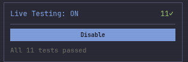
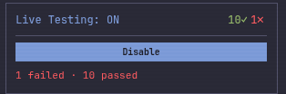

# Live testing without an agent

You edit a function, and the tests that touch it run again while you sit there. Red and green show up in your editor. No agent, no MCP, nothing to prompt. This page takes you from "I have an F# project and an editor" to that, and it should take about ten minutes.

I wrote it because someone trying SageFs for plain watch mode told me the docs only explained the agent route. They were right. Everything here I checked against the source, and the worked example near the end I ran against a real daemon on 2026-10-25, on a build reporting 0.6.929. What I could not do from where I ran it is drive VS Code itself, so the editor parts come from reading the extension's source. I say so where it matters.

## 1. Install it and start the daemon

You need the .NET 10 SDK or the .NET 11 SDK, and nothing else ([Get Started](../Readme.md#get-started)).

```bash
dotnet tool install --global SageFs
sagefs check
```

`sagefs check` tells you what is missing and what to do about it. Then build your project once with `dotnet build`. A session loads your compiled output, and the [Troubleshooting page](TROUBLESHOOTING.md#when-health-says-degraded) names a never-built project as the likely reason a session comes up with nothing loaded.

Now start the daemon from your project folder, in a terminal you leave open:

```bash
cd path/to/your/project
sagefs
```

Start it in the project folder and keep it out of your home directory. SageFs refuses to watch a home directory, and a daemon started there gives you sessions with no live testing ([Readme](../Readme.md#run-it-as-a-service-linux), [`classifyWatchRoot`](../SageFs.Core/FileWatcher.fs)).

It listens on two ports. 37749 is the HTTP and MCP API. 37750 is the web dashboard, at `http://localhost:37750/dashboard`. `sagefs status` says whether it is up, and exits 1 if it is not.

In VS Code you can skip this step. The extension starts the daemon for you when it finds none (setting `sagefs.autoStart`, on by default). It starts it with `--ttl 4h`, so that daemon gives up after four hours with no sessions and no clients ([`DaemonDiscovery.fs`](../sagefs-vscode/src/DaemonDiscovery.fs), [`Program.fs` help text](../SageFs/Program.fs)). Run `sagefs` yourself if you want one that stays.

## 2. Get the editor extension

**VS Code.** The extension is `willehrendreich.sagefs`. Search for SageFs in the Extensions sidebar, or:

```bash
code --install-extension willehrendreich.sagefs
```

CI publishes it to the [VS Code Marketplace](https://marketplace.visualstudio.com/items?itemName=willehrendreich.sagefs) and to [Open VSX](https://open-vsx.org/extension/willehrendreich/sagefs), and attaches the `.vsix` to each [GitHub Release](https://github.com/WillEhrendreich/SageFs/releases) ([`publish.yml`](../.github/workflows/publish.yml)). It needs an editor built on VS Code 1.85 or newer. The extension does not declare Ionide as a dependency, and the two get along ([Readme](../Readme.md)).

**Cursor.** Nothing in this repo mentions Cursor as a place the extension runs. What I know is narrower. The extension is on Open VSX, and the Open VSX publish step in CI is allowed to fail without failing the release, so that listing can lag the Marketplace one. I checked today and it carried 0.6.928. I have not run SageFs in Cursor. If Cursor's extension search does not find it, the `.vsix` from Releases is the fallback (Extensions menu, Install from VSIX). Debugging a failing test needs an extension that provides the `coreclr` debug type, and Microsoft's C# debugger is licensed for Microsoft's own build of VS Code, so in a fork you would need another provider ([LIVE_TESTING_GUIDE.md](LIVE_TESTING_GUIDE.md#debugging-a-failing-test)). If you get it going in Cursor, tell me and I will write it down properly.

**Neovim.** `"WillEhrendreich/sagefs.nvim"` in your plugin manager, with Neovim 0.10 or newer and `curl` on your PATH ([sagefs.nvim README](https://github.com/WillEhrendreich/sagefs.nvim#requirements)). `:SageFsStart` starts the daemon from inside Neovim.

## 3. Open a project and get a session

A session is your project loaded into an F# Interactive process. Live testing runs against a session, so you need one.

In VS Code, open the folder that holds your `.fsproj`, `.sln` or `.slnx`. The extension wakes up for an F# file or for any of those files in the workspace. What it does by itself:

- It connects to the daemon, or starts one. While it starts, the status bar says `SageFs starting... (3s)` and counts up.
- If the daemon has no session, about two seconds after connecting it asks "SageFs is running but has no session. Create one for your project?" with two buttons, **Create Session** and **Not Now**.

What it does not do is create a session without being told to. Click the button, or run **SageFs: Create Session** from the Command Palette, or click **Create Session** in the SageFs view in the activity bar (the one with the flame icon), which shows that link when there is no session.

The status bar item on the left then tells you where you are:

| Status bar | Meaning |
|---|---|
| `SageFs: ready (no session)` | Daemon is up, you have no session. |
| spinning icon, `SageFs: MyProject [REPL]` | The session is Starting. |
| bolt icon, `SageFs: MyProject [REPL]` | Ready. The text in brackets is the workflow. |

I ran the session creation twice. On a daemon that had already been running it was Ready in about ten seconds. On a brand new daemon it took 62 seconds, on a machine that was busy with other work. The first session on a new daemon is the slow one.

In Neovim it is `:SageFsCreateSession`, and `:SageFsStatus` shows daemon, session and test state in one float. In the dashboard it is the **+** in the Sessions panel.

## 4. Turn live testing on

A session you just created is in the REPL workflow, and live testing is off. The status bar item for tests says so (`Live testing off`). Turning it on is one step.

**VS Code.** Run **SageFs: Enable Live Testing** from the Command Palette. It only shows up when a session exists and live testing is off, and it flips to **SageFs: Disable Live Testing** once on. You can also click the test item in the status bar, the one with the beaker. While live testing is off its tooltip tells you to click to enable it, and the click runs the same command ([`Extension.fs`](../sagefs-vscode/src/Extension.fs)).

There is a second route. **SageFs: Switch Workflow**, then Live Testing, turns it on for you once the session is ready, and the tests re-run on debounced keystrokes. It restarts the session in place, so REPL bindings you had are gone. If you came for the test loop and nothing else, that is a fine way to start.

**Neovim.** `:SageFsEnableTesting`, or `<leader>rte` in an F# buffer ([sagefs.nvim README](https://github.com/WillEhrendreich/sagefs.nvim#commands)). `:SageFsWorkflow livetesting` is the other route.

**Web dashboard.** Open `http://localhost:37750/dashboard`. The Live Testing panel in the sidebar has an **Enable** button, and while it is off it says "Enable to run tests on every keystroke and file save." Once on, the header reads `Live Testing: ON`, the button becomes **Disable**, and the pass and fail counts sit beside it ([`DashboardFragments.fs`](../SageFs/DashboardFragments.fs)).

**Plain HTTP, as a last resort.** Find your session id, then enable it:

```bash
curl -s http://localhost:37749/api/sessions
curl -s -X POST http://localhost:37749/api/live-testing/enable \
  -H 'content-type: application/json' -d '{"sessionId":"<id>"}'
curl -s "http://localhost:37749/api/live-testing/status?session=<id>"
```

Pass the id. On a daemon with several sessions, a status call without one is refused and lists the ids it knows.

## 5. What you see, and where

The daemon works out one state for live testing and every client shows it in the same words ([`LiveTestActivity.fs`](../SageFs.Core/Features/LiveTestActivity.fs)). In VS Code the test item in the status bar carries it, with the full sentence in the tooltip.

| Status bar says | What is going on |
|---|---|
| `Live testing off` | You have not turned it on, or you turned it off. |
| `Looking for tests…` | Discovery is running. Wait. |
| `No tests found` | The session is up and found no test framework. |
| `Running 3 of N` | Those tests are executing now. |
| `All N passed` | Everything that ran, passed. |
| `1 failed · N passed` | At least one red. The item turns red too. |
| `Hello.fs: 2 errors` | Blocked by compile errors. The tooltip says "Waiting for Hello.fs to compile (2 errors)" and shows the last good results. Nothing re-runs until the file type-checks. |
| `Rebuilding N tests` | A real build is running. The last results stay up. |
| `Tests could not re-run` | That build failed. The tooltip has the first compiler error. |
| a warning icon with a stale count | Those tests are out of date because you edited the code since they last ran. |

Below the headline the tooltip gives two more lines. `Last run:` says how SageFs picked the tests, in one of these phrasings: `exact dependency match (3 selected)`, `coverage widened the rerun (3 selected)`, `conservative fallback rebuild (3 selected)`, `no impacted tests were identified`, or `run policy deferred 3 test(s)`. `Why:` is the daemon's full sentence for that choice ([`LiveTestingTypes.fs`](../sagefs-vscode/src/LiveTestingTypes.fs)). When a failing test makes you ask "why did that one run", read these.

In the editor itself, VS Code shows:

- A mark at the end of each test's line: a green `✓`, a red `✗` with a faint red line background, or a `●` while it runs. Hover it for the detail. A failure reads `✗ add infers int: <message>`. A stale one gets a `◌` and says that your code changed since the test last ran.
- A lens above each test: `✓ Passed (12ms)`, `✗ Failed: ...`, `● Running…`, `◌ Stale`, `◆ Not yet run`. A failing test gets a `Debug` lens next to it. Clicking the result lens runs that test.
- Coverage marks before covered lines: `▸` in green when the covering tests pass, in red when one fails, and `○` in grey for lines no test reaches.
- The Testing view in the activity bar, with a controller named **SageFs Live Tests**. VS Code's own gutter icons for run and debug come from there.

The marks at the end of the line and the coverage marks are drawn by the extension, so the setting `sagefs.density` (`full`, `normal`, `minimal`) decides how many of them you get. **SageFs: Cycle Density** steps through the three. **SageFs: Next Failing Test** is `Alt+Shift+]`, and the previous one is `Alt+Shift+[`.

In Neovim you get signs in the sign column and a test panel (`:SageFsTestPanel`, `<leader>rt`) where `<CR>` jumps to the source.

The dashboard shows it too. This is its Live Testing panel once the sample's tests have all passed:



And this is the same session after I broke a test on purpose:



While a save's confirming build runs, the session card above that panel also carries an amber "Rebuilding" note, and the status badge in the header reads "Ready, rebuilding".

## 6. A worked example

I used the C# bridge sample, because its tests sit in the same file as the code they test. That makes it short, and it also decides how SageFs picks tests, as you will see.

```bash
cd samples/from-csharp/SageFs.Samples.FromCSharp
dotnet build
```

Create a session for `SageFs.Samples.FromCSharp.fsproj` (VS Code: **SageFs: Create Session**) and turn live testing on. I did it over HTTP so I could time it:

```bash
curl -s -X POST http://localhost:37749/api/sessions/create \
  -H 'content-type: application/json' \
  -d '{"workingDirectory":"/abs/path/samples/from-csharp/SageFs.Samples.FromCSharp","projects":["/abs/path/samples/from-csharp/SageFs.Samples.FromCSharp/SageFs.Samples.FromCSharp.fsproj"]}'
```

It answered `{"message":"14569033","success":true}`, which is the session id. Once the session was Ready I enabled live testing. It answered in 25 milliseconds, and two seconds later every test had passed: `Summary` in the status call read `Passed` equal to `Total`, `Failed` 0, `DiscoveryState` `ready_with_tests`. The dashboard output logged a `Test run complete` line with nothing failed.

**Make a test go red.** Open `Hello.fs` and change line 49, then save:

```fsharp
let add a b = a - b
```

Four point nine seconds later the status call showed one failure, and the failing test was `add infers int`:

```
3 + 4 = 7.
expected: 7
  actual: -1
```

The daemon's reason for picking tests was: "Coverage evidence widened the impacted set because the symbol graph alone could not explain this file change." Every test in the file ran. The sample keeps its tests next to its code, so every test reaches a symbol in the file that changed, and SageFs reruns them all when it cannot do better. In a project where the tests live in their own file you get a smaller set. The long version is in [How SageFs runs your tests as you type](how-live-testing-works.md).

**Make it green.** Change it back to `a + b` and save. The status call showed all tests passing 6.2 seconds later.

Those times are slow. The load average on the machine was around 45 on 8 cores, with other agents building on it. [how-live-testing-works.md](how-live-testing-works.md) reports about 0.7 seconds from an edit to a verdict, measured on one quiet 16-thread machine. I have no number for a calm laptop.

After a save there is a second step. About two seconds after your edits go quiet, SageFs starts a real build of the saved text and runs the tests again against it, to confirm or contradict the first answer. It took about 35 seconds on that loaded machine. While it runs, the dashboard session card shows an amber "Rebuilding" note and the status call says `"Confirmation":"building"`. It restarts the worker, so the output pane shows a fresh `Loaded ... FSI session created` block. The verdict stays on screen the whole time.

The whole thing, from creating the session to seeing green again, took under three minutes, and most of that was the cold start and me typing.

I drove saves, and the daemon half. I did not watch the keystroke path in a real VS Code window, which posts your unsaved buffer to the daemon 300 milliseconds after you stop typing. The marks and lenses described in section 5 come from the extension source.

## 7. When nothing happens

Three causes cover most of it. Check them in this order.

**The session is not Ready.** The status bar says `SageFs: ready (no session)`, or shows the spinner. Live testing needs a session that has finished warmup. A fresh daemon's first session took me a minute. `GET /api/sessions` shows `status`, and the dashboard shows `Ready` in the header. If it never gets there, the log has why ([Where the logs are](TROUBLESHOOTING.md#where-the-logs-are)), and the VS Code command **SageFs: Check Health** is the first thing to run ([Troubleshooting](TROUBLESHOOTING.md#editor-health-checks-start-here)).

**Live testing is off.** A new session starts in the REPL workflow with it off. Go back to section 4. The status bar says `Live testing off` when this is the problem. Also check the run policy. Unit and property tests re-run on every change, but integration and browser tests default to on demand, so a test in one of those categories will not move when you edit. **SageFs: Set Test Run Policy** changes it ([Troubleshooting](TROUBLESHOOTING.md#live-testing-not-running)).

**The session loaded nothing, or nothing is watching.** The session is Ready and the tests never appear, or they appear and never react to a save. Two usual reasons. Your project was never built, so warmup opened zero namespaces. Run `dotnet build` and rebuild the session (**SageFs: Hard Reset (Rebuild)** in VS Code, `:SageFsHardReset` in Neovim). Or the daemon was started in your home directory, where the file watcher refuses to run. The daemon log says `Not watching <dir>` and why, and the fix is to restart it from the project folder ([`FileWatcher.fs`](../SageFs.Core/FileWatcher.fs)).

One more, which I hit and which is fixed. On a daemon shared with several other sessions, I turned live testing on for mine, saved an edit, and nothing moved. I sent the buffer to the daemon the way the editor does and nothing moved either. A fresh daemon with one session reacted each time. The cause was in [`SageFsApp.fs`](../SageFs/SageFsApp.fs): the handlers for a saved file and for an unsaved buffer first asked whether the daemon's primary session had live testing on, and dropped the change when it did not. The primary was one of the other sessions, with it off, so my session's change never arrived. Now a change goes to the sessions whose folder contains the file, and reaches each one that has live testing on, whichever session is primary ([`LiveTestFileRouting.fs`](../SageFs.Core/LiveTestFileRouting.fs)). A daemon built before that fix still drops the change, so if one session out of several goes quiet, check `sagefs --version` first and update.

A type error in the file you are editing is not a hang. The status bar shows the file name and the error count, and the last good results stay up until the file compiles.

## 8. Debug a failing test from the editor

In VS Code, click `Debug` in the lens above a red test, or the Debug link in its hover, or **Debug Test** in the Testing view. The extension attaches a .NET debugger to the process that runs your tests. Breakpoints bind in your compiled project code and do not bind in code you evaluated in the session. The rest, including the Neovim route (`:SageFsDebugTest`), is in [LIVE_TESTING_GUIDE.md](LIVE_TESTING_GUIDE.md#debugging-a-failing-test).

## Where to go next

- [How SageFs runs your tests as you type](how-live-testing-works.md) for how the tests get chosen and what the confirming build is.
- [Workflow Modes](workflow-modes.md) for how the Live Testing workflow differs from the toggle.
- [The VS Code extension README](../sagefs-vscode/README.md) for every command and setting.
- [Troubleshooting](TROUBLESHOOTING.md) when something above did not match what you saw. If it did not, file it.
